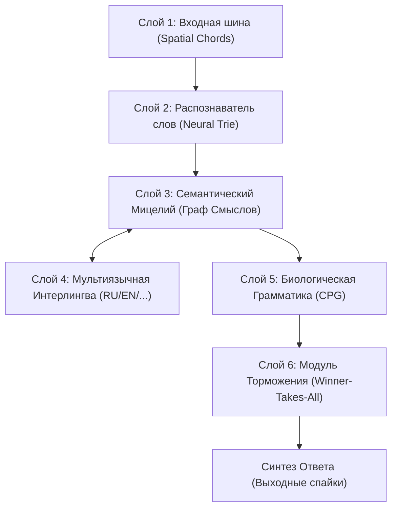

# Проект Mycelium: Архитектура, Стенограмма Исследований и Дорожная Карта

> **Статус проекта:** Закрытая концептуальная разработка (Proprietary / Closed Research).  
> **Формат документа:** Концептуальный манифест, хроника прототипирования и детальная архитектурная спецификация (без раскрытия низкоуровневого кода ядра).

---

## 1. Фундаментальная Философия и Концепция

Современная индустрия искусственного интеллекта зашла в тупик матричных вычислений. Классические Transformer-архитектуры и LLM работают как ресурсоемкие «калькуляторы вероятностей»:
* Огромные матрицы вещественных чисел (Float16/Float32);
* Миллиарды перемножений и обращений к памяти ради одного токена;
* Непрерывная трата вычислительной энергии на вычисление «нулей» и пустоты;
* Отсутствие биологической достоверности, локального обучения и структурного понимания смыслов.

### Архитектурный постулат Mycelium:
> **«Избавиться от нулей и использовать только единицы (события). Заменить непрерывную матричную кашу топологией биологического мицелия и спайковой физикой.»**

В **Mycelium** информация не вычисляется бесконечными перемножениями весов — она **протекает** в виде электрических импульсов (спайков) по графу синапсов. Память и процессинг объединены в одной точке:
1. **Дискретность событий:** Время и энергия тратятся только тогда, когда происходит спайк (1). Пустота (0) не требует машинных ресурсов.
2. **Форма рождает формулу:** Семантика естественного языка задается геометрией графа, а не вектором в пространстве эмбеддингов.
3. **Нативный движок:** Архитектура создается с прицелом на кастомную спайковую виртуальную машину (`spikeasm_vm`) на базе DSL `Beszercess` с поддержкой био-пластичности (STDP/LTD) и параллельного вычисления на Apple Metal GPU.

---

## 2. Стенограмма Этапов Разработки (Отчет о Проделанной Работе)

Ниже зафиксирована хронология исследований, гипотез, экспериментов и полученных результатов:

### Этап 1: Семантическое Ядро (Semantic Core)
* **Идея:** Проверить, может ли простая сеть узлов с пороговым возбуждением связывать разрозненные слова в единую концепцию.
* **Эксперимент:** Спроектирована топология, в которой слова сходятся к абстрактным концептам.
* **Результат:** Доказано, что одновременное возбуждение нескольких базовых слов суммирует потенциал на целевом узле смысла и вызывает его спайк без математических матриц.

### Этап 2: Проблема комбинаторного взрыва и Префиксное Дерево (Neural Trie)
* **Проблема:** Если связать 50 000 слов напрямую с базовыми буквами, очередь событий виртуальной машины мгновенно переполнится (`EventQueue overflow`).
* **Решение:** Построена иерархическая структура префиксного дерева (Trie) на спайках: `C` $\to$ `CA` $\to$ `CAT`. 
* **Результат:** Нагрузка на планировщик событий снижена на порядки. Распознавание слова происходит пошагово по мере поступления символов через промежуточные синаптические узлы-слоги.

### Этап 3: Отказ от временного кодирования (Морзе) в пользу Пространственных Аккордов
* **Критическая ошибка первоначального плана:** Первая попытка кодировать буквы через временные задержки (как в азбуке Морзе: точка/тире) вернула в систему «нули» (ожидание тактов задержки) и затормозила распознавание.
* **Архитектурный прорыв:** Переход на **Пространственные Аккорды (Spatial Chords)**. 
* **Реализация:** Спроектирована 8-битная параллельная шина рецепторов (`BUS_0` .. `BUS_7`). Каждая буква кодируется одновременным ударом строго 3 уникальных рецепторов на такте $t=0$ с задержкой `delay = 0`.
* **Результат:** Мгновенное распознавание букв без ожидания времени. Использованы только «единицы».

### Этап 4: Генерация Семантической Формы из Толкового Словаря (Webster)
* **Идея:** Словарю нужна форма, а форма создаст биологическую формулу понимания.
* **Реализация:** Разработан конвейер парсинга толкового словаря английского языка (86 000+ словарных статей). Словарь очищен от синтаксического шума, а каждое определение деконструировано на ключевые концепты.
* **Результат:** 
  * Сгенерирован граф смыслов из **16 165 уникальных узлов концептов**.
  * Каждое слово через синапсы запитало свои семантические свойства (например: `WORD_ABACUS` активирует `CONCEPT_CALCULATING`, `CONCEPT_TABLE`, `CONCEPT_FRAME`).
  * Получена сеть обратного поиска: подача спайков в концепты находит ассоциированные слова топологически.

### Этап 5: Биологическая Грамматика (Central Pattern Generator / CPG)
* **Идея:** Мозгу нужен «формуляр» для построения связной речи во времени, иначе слова вывалятся хаотичной массой.
* **Реализация:** Спроектирован биологический контур CPG — внутренние ритмические часы с жесткими задержками активации грамматических слотов:
  * $t=0$: Слот Субъекта (`SLOT_SUBJECT`)
  * $t=10$: Слот Глагола (`SLOT_VERB`)
  * $t=20$: Слот Объекта (`SLOT_OBJECT`)
* **Результат:** Слова выдаются последовательно, только если на них одновременно сошлись две энергии: заряд от смысла (семантика) и заряд от грамматического слота (синтаксис).

---

## 3. Текущее Состояние и Архитектурный Рубеж

В точке фиксации обнаружены две критические архитектурные задачи:

1. **Проблема «Эпилепсии Сети» (Отсутствие Торможения):**
   * *Симптом:* При активации грамматического слота (например, `SLOT_SUBJECT`) все активные синонимы или связанные существительные в графе могут превысить порог одновременно. Сеть выдает словесную кашу вместо одного слова.
   * *Решение:* Внедрение механизма **Бокового Торможения (Lateral Inhibition / Winner-Takes-All)** через отрицательные веса (LTD). Первый победивший узел мгновенно блокирует соседей.

2. **Мультиязычность через Семантический Интерлингва-Протокол:**
   * Протокол концептов (`CONCEPT_*`) инвариантен к языкам.
   * Английское `WORD_APPLE` и русское `WORD_ЯБЛОКО` подсоединены к одним и тем же узлам (`CONCEPT_FRUIT`, `CONCEPT_RED`).
   * Перевод реализуется не внешней моделью, а векторным переключением возбуждения/подавления языковых лексиконов при сохранении смыслового паттерна.

---

## 4. Комплексный План Дальнейших Действий

### Фаза 1: Стабилизация Динамики (Борьба с Эпилепсией)
* [ ] Спроектировать тормозящие контуры (LTD / отрицательные веса) для узлов одного грамматического и семантического класса.
* [ ] Ввести локальные интернейроны-супрессоры: как только узел слова преодолевает порог $V_{th}$, он генерирует тормозной спайк по кластеру конкурентов.

### Фаза 2: Мультиязычное Расширение (RU + EN)
* [ ] Подключить русскоязычный толковый тезаурус.
* [ ] Связать русские слова с существующей базой концептов `CONCEPT_*`.
* [ ] Реализовать «переключатель контекста языка» через управляющий спайковый пул.

### Фаза 3: Интеграция с Движком `spikeasm_vm`
* [ ] Скомпилировать тестовый блок графа Mycelium в нативный байткод VM.
* [ ] Провести валидацию на аппаратном стенде (Apple Metal GPU / CPU).
* [ ] Замерить задержки отклика, потребление памяти и стабильность очереди событий.

### Фаза 4: Диалоговый Протокол
* [ ] Создать петлю обратной связи (рекуррентные синапсы кратковременной памяти контекста).
* [ ] Реализовать интерфейс подачи пользовательских вопросов и считывания выходных паттернов.
