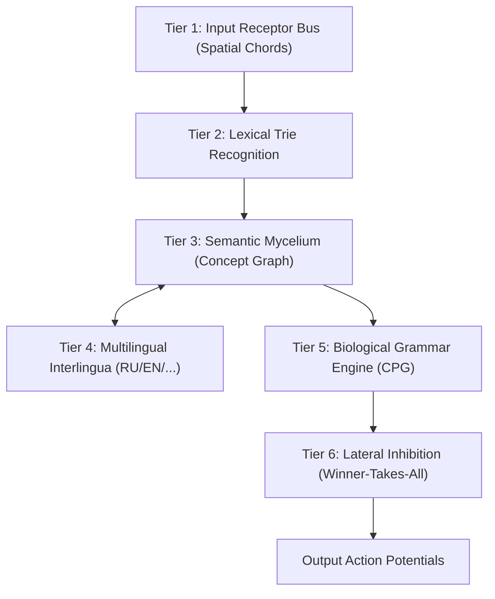

# Project Mycelium: Architecture, Research Chronicle & Roadmap

> **Project Status:** Closed Conceptual R&D (Proprietary / Closed Research).  
> **Document Purpose:** Architectural manifesto, prototyping chronicle, and high-level technical specifications (omitting proprietary engine source code).

---

## 1. Foundational Philosophy and Core Concept

The modern artificial intelligence industry has arrived at a compute bottleneck driven by dense matrix algebra. Conventional Transformer architectures and Large Language Models function as power-hungry probability calculators:
* Vast matrices of floating-point numbers (Float16/Float32);
* Billions of floating-point multiplications and memory reads per generated token;
* Continuous dissipation of computing cycles calculating inactive parameters and "zeros";
* Lack of biological fidelity, localized learning, and structural semantic representation.

### Architectural Postulate of Mycelium:
> **"Eliminate all computational zeroes and process active events ('ones') exclusively. Replace dense matrix arithmetic with the topology of biological mycelium and spiking dynamics."**

In **Mycelium**, knowledge is not computed via dense weight multiplication — it **flows** as electrical action potentials (spikes) across synaptic topologies. Memory and compute converge:
1. **Event-Driven Computation:** Energy and compute are consumed strictly when an action potential occurs (1). Inactive state (0) incurs zero operational overhead.
2. **Topology Dictates Formula:** Natural language semantics are defined by graph geometry rather than continuous embedding vectors.
3. **Native Engine Integration:** Designed to run directly on the custom `spikeasm_vm` spiking virtual machine leveraging the `Beszercess` DSL, incorporating Spike-Timing-Dependent Plasticity (STDP/LTD) and Apple Metal GPU parallelism.

---

## 2. Research Chronicle (Stage-by-Stage Progression)

A chronological account of hypotheses, experiments, and verified milestones:

### Stage 1: Semantic Core Convergence
* **Concept:** Determine whether threshold-driven node networks can bind disparate lexical tokens into unified semantic constructs.
* **Experiment:** Designed a topology where lexical nodes converge onto abstract concept nodes.
* **Result:** Confirmed that concurrent activation across multiple words integrates membrane potential onto target conceptual nodes, triggering action potentials without matrix dot-products.

### Stage 2: Combinatorial Explosion & Neural Prefix Trees (Trie)
* **Challenge:** Directly connecting 50,000+ words to fundamental character receptors saturates the virtual machine's event queue (`EventQueue overflow`).
* **Resolution:** Engineered a hierarchical Spiking Prefix Tree (Trie): `C` $\to$ `CA` $\to$ `CAT`.
* **Result:** Event scheduler pressure dropped by orders of magnitude. Word recognition occurs progressively through intermediate syllable nodes as symbols arrive.

### Stage 3: Spatial Chords over Temporal Delays (Morse Deprecation)
* **Design Flaw in Initial Prototype:** Serial temporal delays (dot/dash intervals) re-introduced computational wait times ("zeros") and throttled throughput.
* **Breakthrough:** Transitioned to **Spatial Chords**.
* **Implementation:** An 8-bit parallel receptor bus (`BUS_0` .. `BUS_7`). Each character maps to a unique 3-receptor chord firing synchronously at $t=0$ with `delay = 0`.
* **Result:** Instantaneous character classification with zero pipeline latency, operating strictly on active spikes.

### Stage 4: Semantic Form Extraction via Lexical Corpus (Webster)
* **Concept:** Language structure requires a structural template, which in turn defines an operational formula.
* **Implementation:** Parsed an 86,000+ entry English dictionary. Stripped syntactic noise and extracted core semantic definitions.
* **Result:**
  * Synthesized a knowledge graph comprising **16,165 unique concept nodes**.
  * Each word activates its conceptual attributes through synaptic pathways (e.g., `WORD_ABACUS` drives `CONCEPT_CALCULATING`, `CONCEPT_TABLE`, `CONCEPT_FRAME`).
  * Enables associative reverse-lookup: injecting spikes into conceptual nodes topological activates associated vocabulary.

### Stage 5: Biological Grammar (Central Pattern Generator / CPG)
* **Concept:** Syntactic coherence requires temporal coordination, preventing unordered activation bursts.
* **Implementation:** Engineered an autonomous biological CPG oscillator with calibrated delay intervals:
  * $t=0$: Subject Slot (`SLOT_SUBJECT`)
  * $t=10$: Verb Slot (`SLOT_VERB`)
  * $t=20$: Object Slot (`SLOT_OBJECT`)
* **Result:** Words fire sequentially only when receiving concurrent stimulation from both semantic activation and the grammatical gating signal.

---

## 3. Current Frontier & Identified Challenges

1. **Network Hyper-Activation (Absence of Lateral Inhibition):**
   * *Symptom:* Triggering a grammatical slot (e.g., `SLOT_SUBJECT`) can cause all semantically primed synonyms or related nouns to exceed firing thresholds simultaneously, producing an unstructured word cascade.
   * *Resolution:* Implementation of **Lateral Inhibition / Winner-Takes-All (WTA)** dynamics using negative synaptic weights (LTD). The first winning node instantaneously suppresses neighboring competitors.

2. **Cross-Lingual Semantic Interlingua:**
   * Conceptual nodes (`CONCEPT_*`) are language-agnostic.
   * English `WORD_APPLE` and Russian `WORD_ЯБЛОКО` terminate on the identical semantic nodes (`CONCEPT_FRUIT`, `CONCEPT_RED`).
   * Translation is accomplished by selective gating of linguistic sub-networks without altering the underlying conceptual pattern.

---

## 4. Comprehensive Engineering Roadmap

### Phase 1: Dynamic Stabilization (Inhibition Engine)
* [ ] Implement lateral inhibition circuits (negative weights) across competing lexical nodes within identical grammatical categories.
* [ ] Integrate inhibitory interneurons to suppress rival nodes once threshold $V_{th}$ is reached.

### Phase 2: Multilingual Expansion (RU + EN)
* [ ] Ingest Russian explanatory lexical databases.
* [ ] Bind Russian vocabulary to the invariant `CONCEPT_*` topology.
* [ ] Implement language context gating via regulatory spike pools.

### Phase 3: Hardware Verification on `spikeasm_vm`
* [ ] Compile Mycelium graph modules into native VM bytecode.
* [ ] Benchmark on physical hardware (Apple Silicon / Metal GPU).
* [ ] Measure response latency, memory profiles, and event queue stability.

### Phase 4: Conversational Protocol
* [ ] Design recurrent synaptic feedback loops for short-term contextual memory.
* [ ] Establish an interactive interrogation interface.
