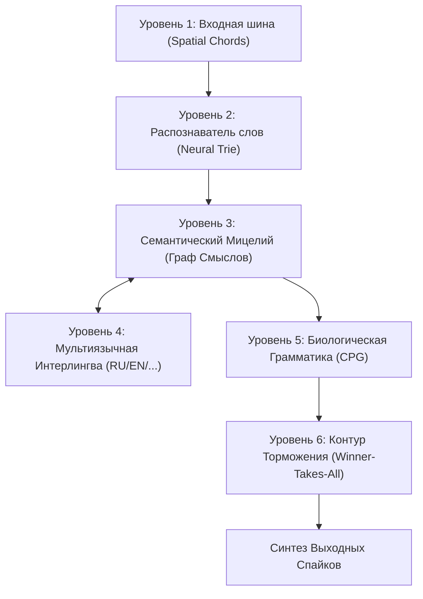

# Проект Mycelium: Архитектура, Стенограмма Исследований и Дорожная Карта

> **Статус Проекта:** Закрытая Концептуальная Разработка (Proprietary / Closed Research).  
> **Цель Документа:** Архитектурный манифест, стенограмма прототипирования и высокоуровневая техническая спецификация (без раскрытия исходного кода ядра).

*English version: [ARCHITECTURE_MYCELIUM.md](ARCHITECTURE_MYCELIUM.md)*

---

## 1. Фундаментальная Философия и Базовая Концепция

Современная индустрия искусственного интеллекта зашла в тупик матричных вычислений. Классические Transformer-архитектуры и LLM работают как энергоемкие калькуляторы вероятностей:
* Огромные матрицы вещественных чисел (Float16/Float32);
* Миллиарды перемножений и обращений к памяти ради одного токена;
* Непрерывная трата циклов на вычисление пассивных параметров и «нулей»;
* Отсутствие биологической достоверности, локального обучения и структурного понимания смыслов.

### Архитектурный Постулат Mycelium:
> **«Исключить все вычислительные нули и обрабатывать исключительно активные события (единицы). Заменить плоские матрицы топологией биологического мицелия и динамикой спайков.»**

В **Mycelium** знания не вычисляются плотным умножением весов — они **протекают** в виде потенциалов действия (спайков) по топологии синапсов. Память и вычисления сходятся:
1. **Событийные Вычисления:** Ресурсы потребляются строго в момент спайка (1). Пассивное состояние (0) не создает вычислительных расходов.
2. **Топология Диктует Формулу:** Семантика языка определяется геометрией графа, а не векторами в пространстве эмбеддингов.
3. **Нативная Интеграция со Средой Исполнения:** Разработано для прямого запуска в виртуальной машине `spikeasm_vm` на базе DSL `Beszercess` с поддержкой био-пластичности (STDP/LTD) и параллелизма Apple Metal GPU.

---

## 2. Стенограмма Исследований (Пошаговое Развитие)

Хронологический отчет о гипотезах, экспериментах и подтвержденных рубежах:

### Этап 1: Сходимость Семантического Ядра
* **Концепт:** Проверить, способны ли пороговые узлы объединять разрозненные слова в целостные смысловые конструкции.
* **Эксперимент:** Спроектирована топология, в которой слова сходятся к абстрактным концептам.
* **Результат:** Подтверждено, что одновременное возбуждение нескольких слов суммирует потенциал на целевом узле смысла и вызывает его спайк без векторных матриц.

### Этап 2: Преодоление Комбинаторного Взрыва и Деревья Neural Trie
* **Проблема:** Прямое подключение 50 000+ слов к рецепторам букв переполняет очередь планировщика VM (`EventQueue overflow`).
* **Решение:** Построено иерархическое спайковое префиксное дерево (Trie): `C` $\to$ `CA` $\to$ `CAT`.
* **Результат:** Нагрузка на планировщик снизилась на порядки. Распознавание слова происходит пошагово по мере поступления символов через промежуточные узлы-слоги.

### Этап 3: Пространственные Аккорды вместо Задержек Морзе
* **Ошибка раннего прототипа:** Временные паузы (точка/тире) вернули в систему «нули» (ожидание тактов) и затормозили распознавание.
* **Прорыв:** Переход на **Пространственные Аккорды (Spatial Chords)**.
* **Реализация:** 8-битная параллельная шина рецепторов (`BUS_0` .. `BUS_7`). Каждая буква кодируется одновременным ударом 3 рецепторов на такте $t=0$ с задержкой `delay = 0`.
* **Результат:** Мгновенное распознавание букв без ожидания времени. Использованы только «единицы».

### Этап 4: Развертывание Семантической Формы из Словаря (Webster)
* **Идея:** Словарю нужна форма, а форма создаст формулу понимания.
* **Реализация:** Разобран массив из 86 000+ статей толкового словаря английского языка с очисткой от синтаксического шума.
* **Результат:** 
  * Синтезирован граф из **16 165 уникальных узлов концептов**.
  * Каждое слово запитало свои семантические свойства через синапсы.
  * Получена сеть обратного ассоциативного поиска: подача спайков в концепты активирует связанные слова топологически.

### Этап 5: Биологическая Грамматика (Central Pattern Generator / CPG)
* **Идея:** Синтаксическая связность требует координации во времени, исключая хаотичный выброс слов.
* **Реализация:** Спроектирован автономный контур CPG с калиброванными задержками слотов:
  * $t=0$: Слот Субъекта (`SLOT_SUBJECT`)
  * $t=10$: Слот Глагола (`SLOT_VERB`)
  * $t=20$: Слот Объекта (`SLOT_OBJECT`)
* **Результат:** Слова выдаются строго последовательно только при одновременном совпадении заряда от смысла и разрешающего импульса от грамматического слота.

---

## 3. Текущий Рубеж и Архитектурные Вызовы

1. **Гиперактивация Сети (Отсутствие Торможения):**
   * *Симптом:* При открытии грамматического слота все близкие синонимы могут превысить порог одновременно, выдавая неструктурированную словесную кашу.
   * *Решение:* Внедрение механизма **Бокового Торможения (Lateral Inhibition / Winner-Takes-All)** через отрицательные веса (LTD). Победивший узел мгновенно блокирует соседей.

2. **Мультиязычный Интерлингва-Протокол:**
   * Узлы смыслов (`CONCEPT_*`) не зависят от языка.
   * Английское `WORD_APPLE` и русское `WORD_ЯБЛОКО` подсоединены к одним и тем же смысловым узлам.
   * Перевод реализуется векторным переключением возбуждения/подавления языковых пулов без искажения картины смыслов.

---

## 4. Комплексная Дорожная Карта

### Фаза 1: Динамическая Стабилизация (Контур Торможения)
* [ ] Построить тормозящие синапсы (отрицательные веса) между узлами одного класса.
* [ ] Внедрить интернейроны-супрессоры для блокировки конкурентов при достижении порога $V_{th}$.

### Фаза 2: Мультиязычное Расширение (RU + EN)
* [ ] Интегрировать русскоязычные толковые тезаурусы.
* [ ] Связать русский лексикон с концептами `CONCEPT_*`.
* [ ] Создать переключатель контекста языка.

### Фаза 3: Аппаратная Валидация на `spikeasm_vm`
* [ ] Скомпилировать граф в нативный байткод VM.
* [ ] Провести тесты на Apple Silicon с Metal GPU.
* [ ] Замерить отклик, потребление памяти и стабильность очереди.

### Фаза 4: Диалоговый Протокол
* [ ] Реализовать рекуррентные синапсы кратковременной памяти контекста.
* [ ] Создать интерактивный диалоговый интерфейс.
